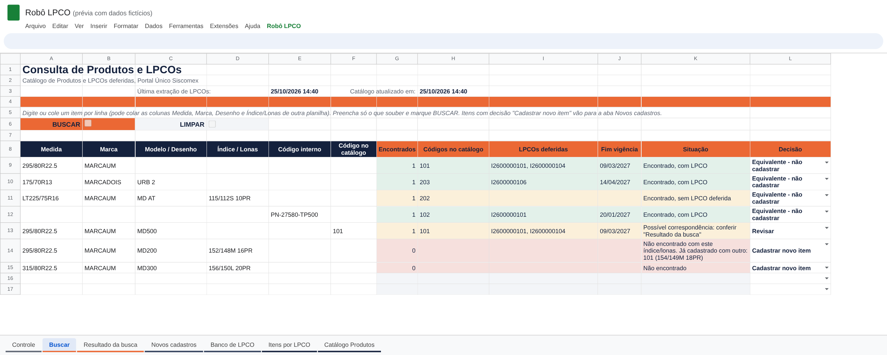

# LPCOs via API do Portal Único Siscomex

  

Controle de LPCOs e gestão do Catálogo de Produtos a partir da API do Portal Único Siscomex, com base consolidada no Google Sheets.

## Problema

A empresa opera com diversos parceiros de desembaraço aduaneiro, o que dificultava o controle das LPCOs emitidas e a gestão do Catálogo de Produtos. Não havia uma visão centralizada para identificar quais itens já estavam cadastrados, quais possuíam LPCO deferida e qual era a vigência de cada licença.

## Lógica

- **Base atualizada automaticamente.** As informações são extraídas pela API oficial do Portal Único para uma planilha do Google Sheets, com atualização diária:
  - LPCOs emitidas, itens do catálogo vinculados a cada uma e vigência;
  - itens do Catálogo de Produtos, com situação, descrição e operador estrangeiro.
- **Consulta por invoice.** O usuário informa os itens de uma invoice e identifica quais já estão cadastrados no Portal Único, se possuem LPCO deferida e até quando ela é válida.
- **Cadastro em lote.** Para os itens sem cadastro, a ferramenta gera a descrição no padrão definido pela empresa, a partir da NCM, e produz o arquivo Excel no modelo de cadastro em lote, enviado ao portal pelo sistema de comércio exterior.
- **Visão que os sistemas não oferecem.** Os sistemas de comércio exterior permitem o cadastro em lote, mas não mostram o que já está cadastrado. A ferramenta preenche essa lacuna.

> Todos os dados deste repositório são fictícios.

## Tecnologias

Python, API REST, Google Apps Script, JavaScript e expressões regulares.
